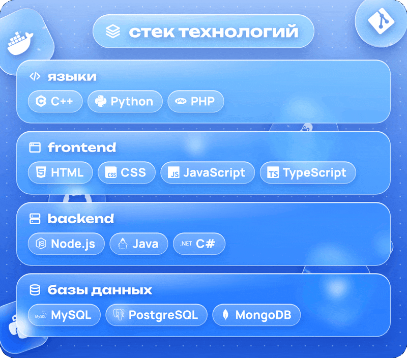

 

---

### 🧠 Обо мне

- 🚀 Middle разработчик, **5+ лет опыта**
- 🛠️ Пишу **Telegram-ботов**, **парсеры**, **чекеры**, **скрипты-автоматизацию** и **веб-сайты**
- 🌐 Делаю простые сайты **бесплатно** по ТЗ - сложные интеграции и нестандартный функционал уже за чашку кофе ☕
- 📩 По вопросам и заказам - в Telegram: [@hokemka](https://t.me/hokemka)

---

---

### 📊 GitHub статистика

---

### 🏆 Трофеи

---

 

 

